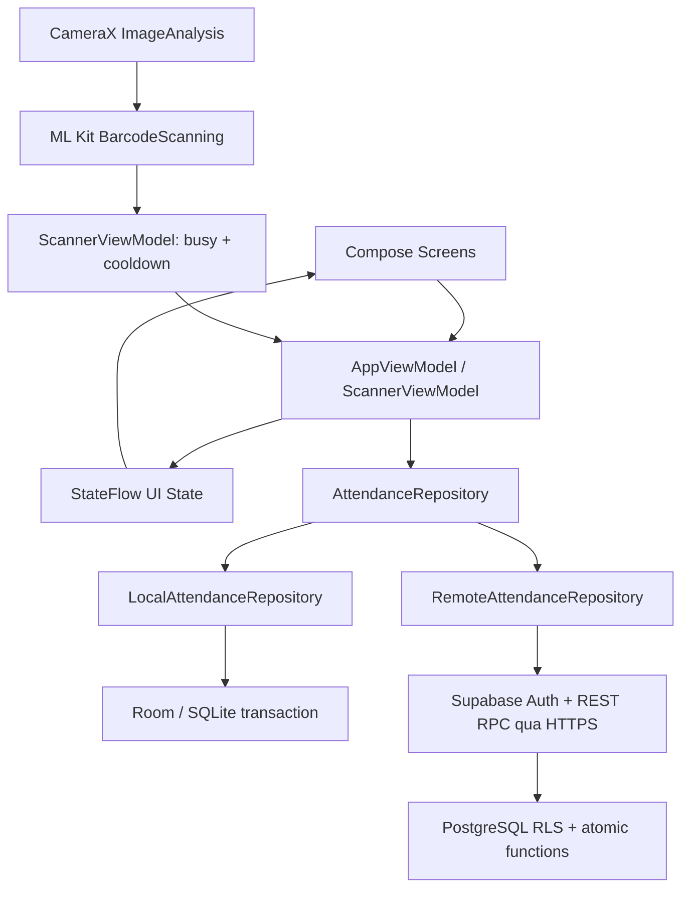

# Kiến trúc

`MainActivity` chỉ cài Compose và theme. `SmartAttendanceApp` là composition root DI thủ công. Domain không phụ thuộc Android/Room; entities dùng `@Embedded` để lưu domain primitive fields, repository chuyển entities sang domain. UI không truy vấn SQL hoặc tự tính quy tắc chấp nhận thẻ.

`AppViewModel` giữ session, snapshot và các thao tác dữ liệu; `ScannerViewModel` có StateFlow riêng để kết quả camera không làm tải lại màn hình. Coroutines và Room suspend API tránh I/O trên main thread; OkHttp chạy ở `Dispatchers.IO`. Mutex tuần tự hóa mutation trên client; transaction/khóa/unique constraint là lớp bảo đảm cuối cùng.

Màn hình được tạo bằng Navigation Compose: startup, login, dashboard, classes, class detail, create session, scanner, attendance list, reports, student detail, settings, admin. Root navigation tái tạo khi đổi tài khoản/chế độ/reset. Vai trò trên UI phục vụ trải nghiệm; quyền thực thi ở repository Demo hoặc RLS/RPC Online.

Camera sử dụng `STRATEGY_KEEP_ONLY_LATEST`, một frame nhận diện tại một thời điểm. `ImageProxy` được đóng trong nhánh bỏ qua, thiếu ảnh, lỗi đồng bộ và completion của ML Kit. Camera bind theo LifecycleOwner; dispose unbind đúng các use case, tắt executor và đóng scanner sau frame đang xử lý. Không thay thế rawValue bằng suy đoán mã sinh viên.

ML Kit model bundled hoạt động offline. Scan thành công chỉ phát âm/rung khi repository trả kết quả commit. Nếu read refresh sau commit thất bại, kết quả scan vẫn được giữ và cảnh báo tải lại; timeout mutation không được coi là thành công.

Online refresh token được mã hóa AES-GCM bằng khóa không xuất được trong Android Keystore; access token ở RAM. Token không ghi log và không backup/cloud transfer. Refresh được serialize bằng mutex; chỉ retry khi máy chủ trả 401, không tự retry request timeout. Đăng xuất xóa token cục bộ kể cả khi máy chủ không thể thu hồi vì mạng lỗi.

Quy mô thiết kế: đồ án/lớp học vừa và nhỏ. Snapshot tải danh sách có quyền vào RAM; hệ thống quy mô lớn nên thay bằng API phân trang và query báo cáo phía server.
